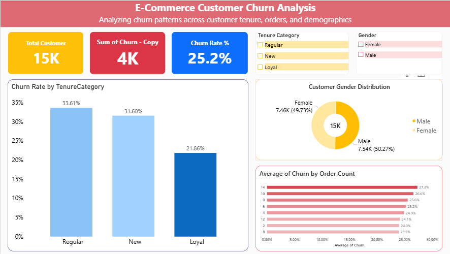

# ecommerce-customer-churn-powerbi
# E-Commerce Customer Churn Analysis (Power BI & Python)

An end-to-end customer churn analytics project combining Exploratory Data Analysis (EDA) in Python with an interactive Power BI dashboard to identify churn patterns across customer tenure, order behavior, and demographics.

## Dashboard Preview

## Key KPIs & Metrics
- **Total Customers:** 15K
- **Churned Customers:** 4K
- **Overall Churn Rate:** 25.19%

## Key Insights
- **Tenure Segments:** Churn rates vary across `New`, `Regular`, and `Loyal` customer segments, highlighting retention opportunities early in the customer lifecycle.
- **Order Activity:** Churn behavior shifts across order counts, helping pinpoint high-risk engagement segments.
- **Interactive Filtering:** Slicers for `TenureCategory` and `Gender` allow dynamic exploration of customer segments and churn rates.

## Repository Contents
- `ecommerce_churn_eda.ipynb` — Data cleaning, preprocessing, feature exploration, and churn analysis in Python.
- `ecommerce_churn_cleaned.csv` — Cleaned dataset used for analysis and reporting.
- `ecommerce_customer_churn_dashboard.pbix` — Power BI report file with KPI cards, churn visuals, and interactive slicers.
- `dashboard_overview.png` — Visual preview of the completed Power BI dashboard.

## Tools & Technologies
- **Python:** Pandas, NumPy, Matplotlib, Seaborn (Jupyter Notebook)
- **Business Intelligence:** Power BI Desktop, Interactive Data Visualization
